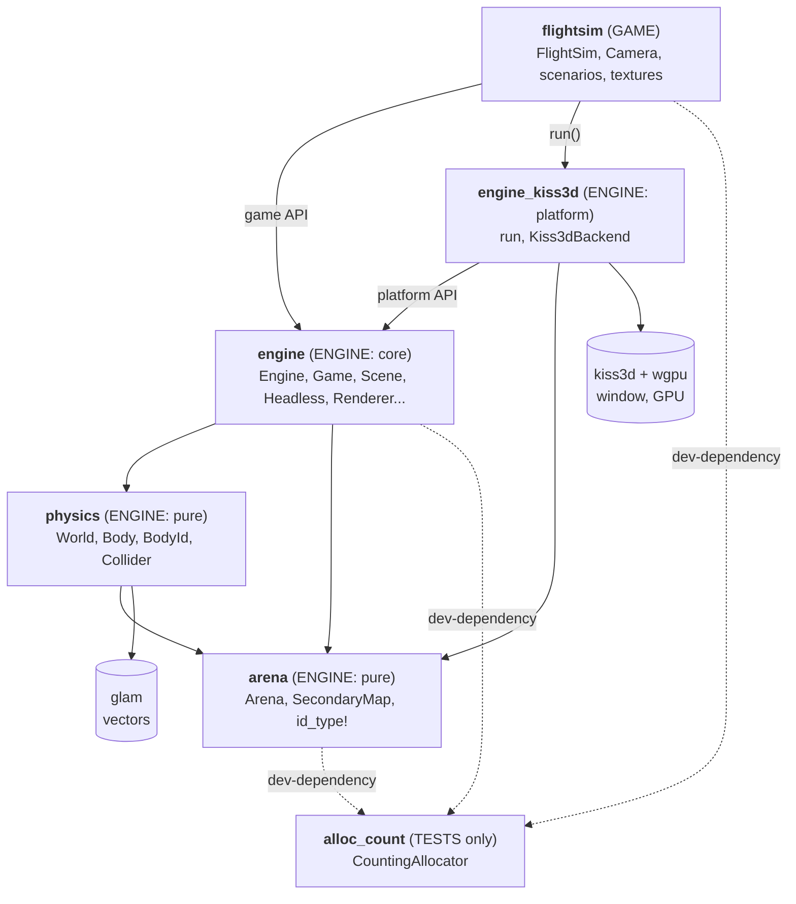
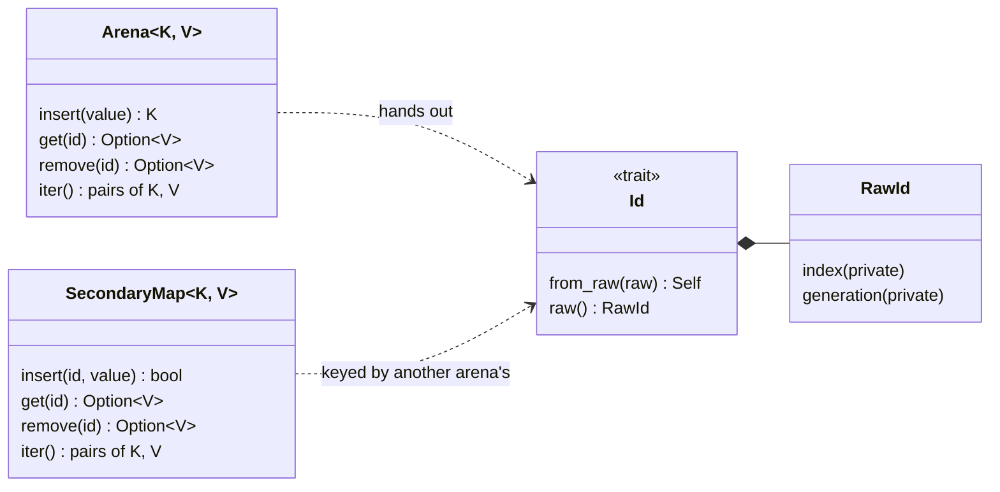
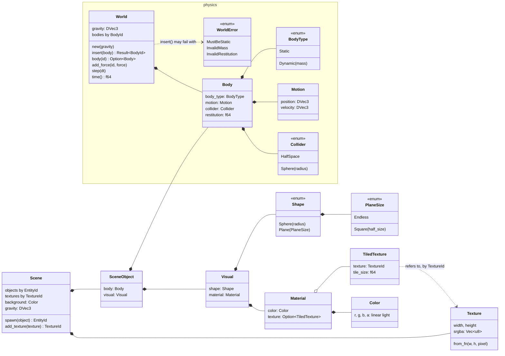
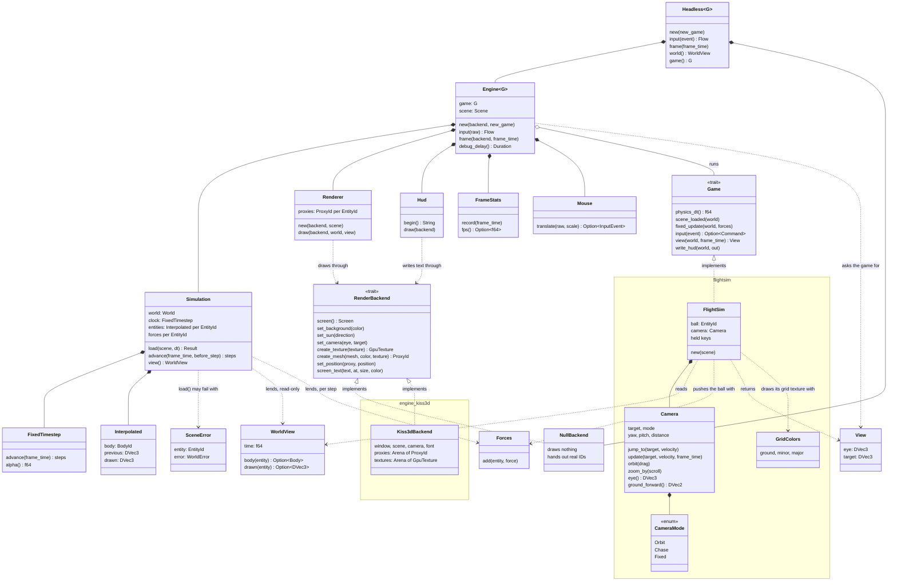
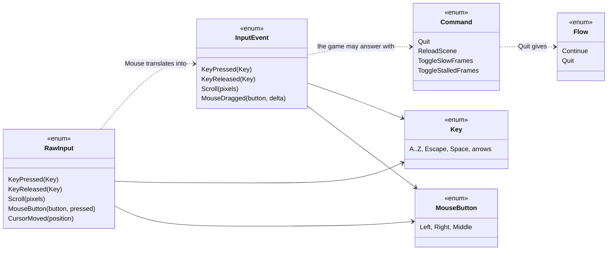
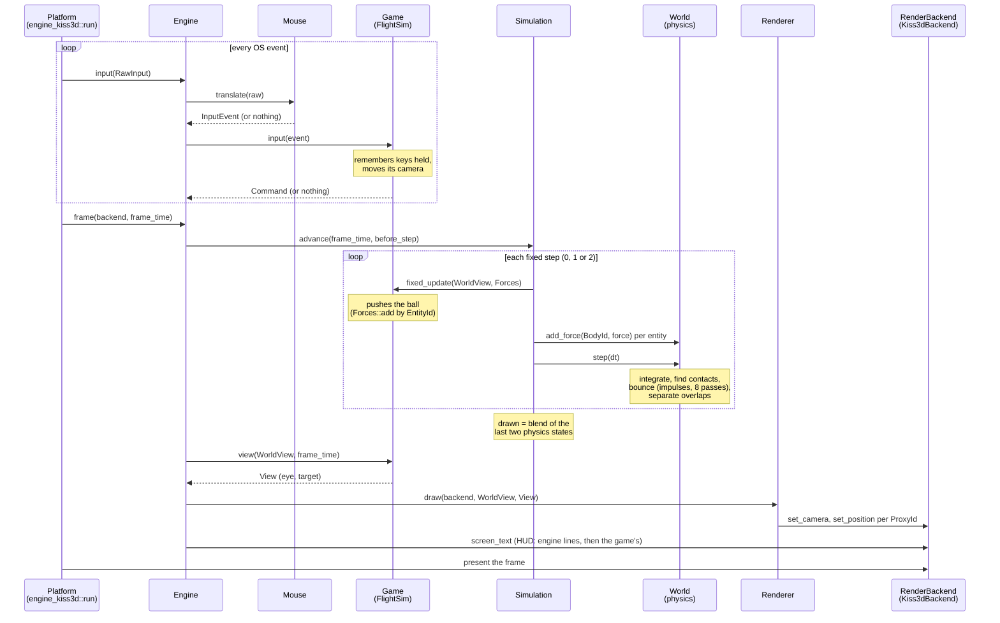

# Architecture

How the code is organised: which layer (crate) needs which types, and how
they work together at run time. Rust has no classes: the equivalents here
are **structs and enums** (data), **traits** (interfaces, like `Game` and
`RenderBackend`), and who **owns** or **borrows** whom.

The diagrams are [Mermaid](https://mermaid.js.org/) (GitHub draws them).
They are kept up to date with the code: every public or crate-visible
type and trait must appear on this page, checked in CI
(`scripts/check-architecture.sh`, see AGENTS.md).

For the *why* behind each choice, see [ROADMAP.md](ROADMAP.md)
"Decisions".

## 1. Layers: the crates and who depends on whom

Dependencies only point one way: the game depends on the engine, the
engine never knows which game it runs. The compiler enforces it.

The `engine` crate shows two faces:

| Who | Imports | Gets |
|---|---|---|
| A **game** (`flightsim`) | `engine::...` (the crate root) | what it implements (`Game`), describes (`Scene`, `SceneObject`, `Visual`, `Shape`, `Material`, `Texture`, the physics types `Body`, `Motion`...) and the IDs it's handed for it (`EntityId`, `TextureId`), reads (`WorldView`), does (`Forces`, `View`, `Command`), receives (`InputEvent`, `Key`, `MouseButton`), and a headless engine to run it in tests (`Headless`, `Flow`) |
| A **platform** (`engine_kiss3d`) | `engine::platform::...` | the engine it runs (`Engine`), the raw input it reports (`RawInput`), the interface it implements (`RenderBackend`) and what that interface carries (`Mesh`, `ProxyId`, `GpuTexture`, `Screen`, `VIEW_DISTANCE`) |

Everything else in the engine is `pub(crate)`: machinery no one outside
can touch (`Simulation`, `Renderer`, `Hud`...). CI checks the game never
imports `engine::platform`.

## 2. IDs: who owns what

Everything stored and referred to elsewhere gets an ID from the `arena`
crate, as in every engine (Bevy's `Entity`, Rapier's handles, Jolt's
`BodyID`, Godot's `RID`): **generated** by the storage on insertion,
**opaque**, **generational** (index + generation: a stale ID finds
nothing) and **typed** (`id_type!`: an `Arena` only takes its own kind of
`Id`).

The rule: **a collection that owns things is an `Arena`** and hands out
their IDs; **data about another arena's things is a `SecondaryMap`**
keyed by their IDs (as an ECS stores a component per entity). Games only
see `EntityId` and `TextureId`; each subsystem keeps its own handles
inside, and the engine maps entities to them (as bevy_rapier maps Bevy
entities to Rapier handles).

| ID | Handed out by (the `Arena`) | Data about it elsewhere (`SecondaryMap`) | Seen by |
|---|---|---|---|
| `EntityId` | `Scene::spawn` (the objects) | `Simulation`: its body and drawn position (`Interpolated`), its forces; `Renderer`: its proxy | games, engine |
| `TextureId` | `Scene::add_texture` (the images) | `Renderer::new`: its uploaded `GpuTexture` | games, engine |
| `BodyId` | `World::insert` (the bodies, like Rapier) | | physics, engine |
| `ProxyId` | the backend's `create_mesh` (its scene nodes, like Godot's `RID`) | | engine, platform |
| `GpuTexture` | the backend's `create_texture` (its GPU textures) | | engine, platform |

## 3. Data: what a scene describes, and what the physics simulates

A **scene** is a description, filled in by the game, which keeps the IDs
it's handed. Loading splits each object under its `EntityId`: its `Body`
goes to the physics `World` (which hands back a `BodyId`), its `Visual`
to the `Renderer` (a proxy).

## 4. Run time: who owns whom, who calls whom

Input types, in `engine::input`:

## 5. Loading, then one frame, step by step

**Loading** (`Engine::new`): the engine hands the game an empty `Scene`;
the game's constructor (`FlightSim::new`) spawns into it and keeps the IDs
it's handed (its ball). The engine then loads the scene: a `World` gets a
body per entity (`Simulation::load`, validated: a `SceneError` names the
bad entity), the backend gets a proxy per entity and each texture once
(`Renderer::new`), and `scene_loaded` lets the game put its camera in
place. The engine keeps the scene: `Command::ReloadScene` loads it again,
giving the same entities, so the game's IDs stay valid. `Headless` does
all this on a `NullBackend`.

**One frame**: the platform owns the loop; each iteration it reports
input, then asks the engine for a frame. Physics runs in fixed steps (0,
1 or 2 per frame); the game acts before each one; then the game chooses
where to look from and the renderer draws.

## 6. Test-only types

Not part of the game, never compiled into it:

- `CountingAllocator` (`alloc_count` crate): counts heap allocations, for
  the zero-allocation tests of the arena, the engine and the game.
- `RecordingBackend` (`engine::render::fakes`): a fake `RenderBackend`
  recording every call, its proxies and textures in arenas as a real
  backend keeps them (Unreal tests against a "null RHI" the same way;
  ours, `NullBackend`, is a real part of the engine: `Headless`).
- `TestGame` (`engine::engine::testing`): a minimal `Game` for the engine's
  tests.
