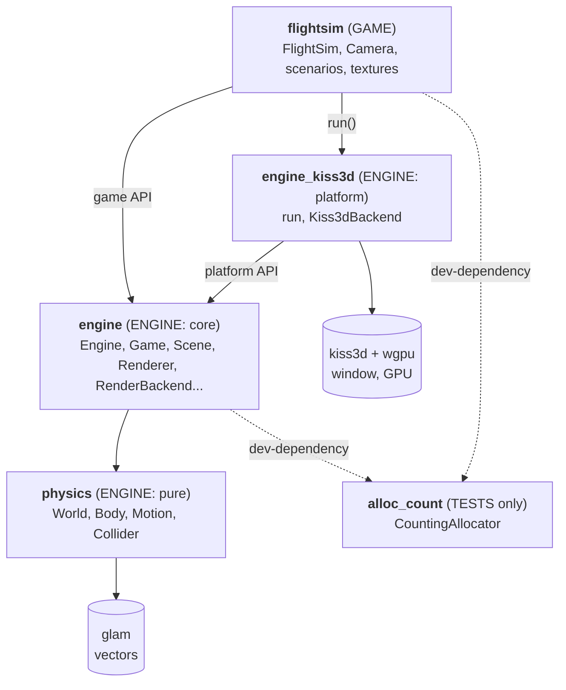
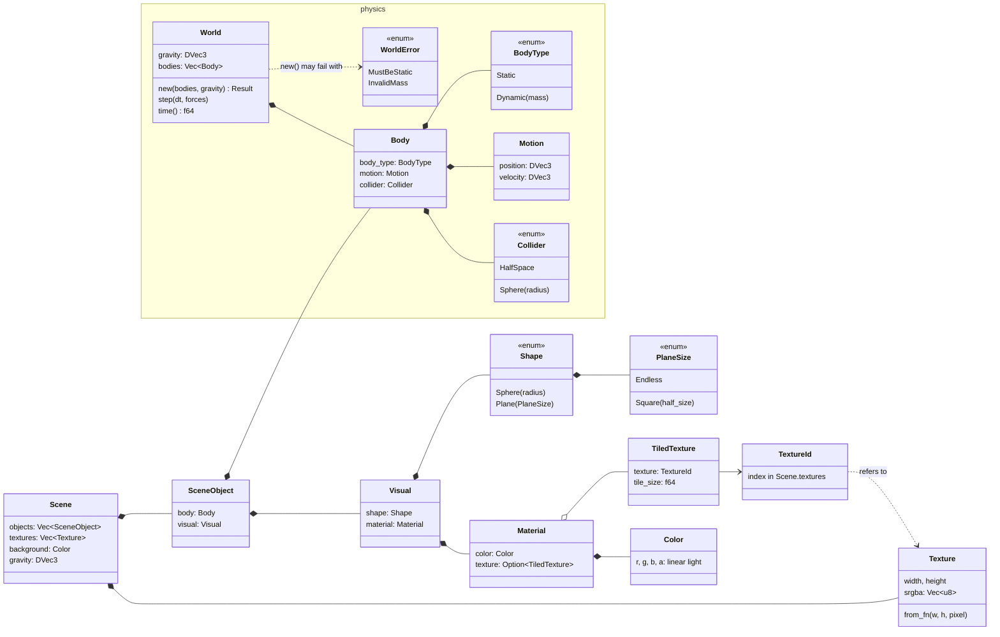
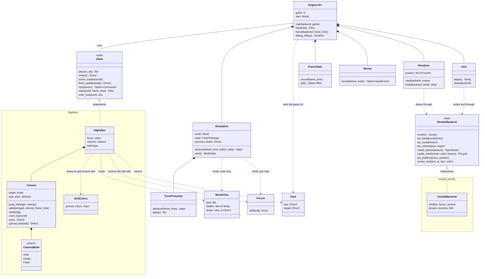
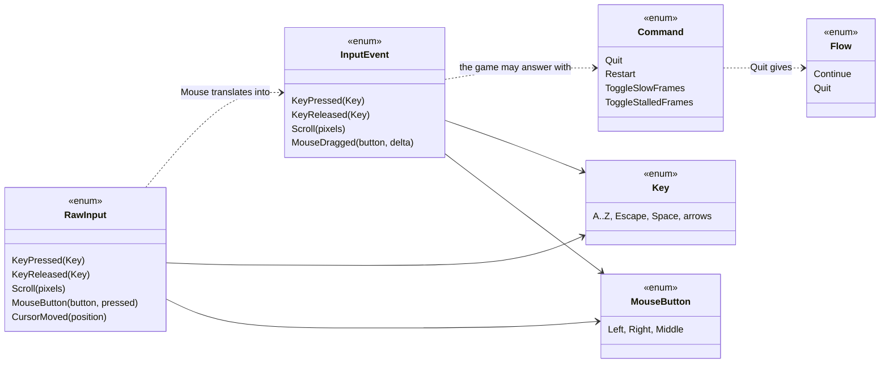
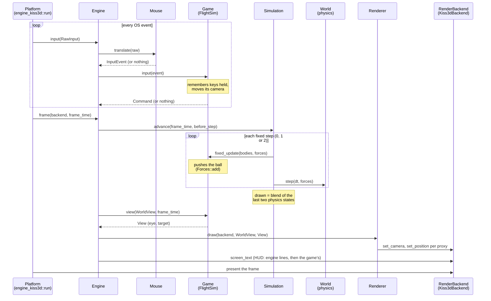

# Architecture

How the code is organised: which layer (crate) needs which types, and how
they work together at run time. Rust has no classes: the equivalents here
are **structs and enums** (data), **traits** (interfaces, like `Game` and
`RenderBackend`), and who **owns** or **borrows** whom.

The diagrams are [Mermaid](https://mermaid.js.org/) (GitHub draws them).
They are kept up to date with the code: every public or crate-visible
type and trait must appear on this page, checked in CI
(`scripts/check-architecture.sh`, see AGENTS.md).

For the *why* behind each choice, see [ROADMAP.md](ROADMAP.md)
"Decisions".

## 1. Layers: the crates and who depends on whom

Dependencies only point one way: the game depends on the engine, the
engine never knows which game it runs. The compiler enforces it.

The `engine` crate shows two faces:

| Who | Imports | Gets |
|---|---|---|
| A **game** (`flightsim`) | `engine::...` (the crate root) | what it implements (`Game`), describes (`Scene`, `SceneObject`, `Visual`, `Shape`, `Material`, `Texture`, the physics types `Body`, `Motion`...), reads (`WorldView`), does (`Forces`, `View`, `Command`), receives (`InputEvent`, `Key`, `MouseButton`) |
| A **platform** (`engine_kiss3d`) | `engine::platform::...` | the engine it runs (`Engine`, `Flow`), the raw input it reports (`RawInput`), the interface it implements (`RenderBackend`) and what that interface carries (`Mesh`, `ProxyId`, `GpuTexture`, `Screen`, `VIEW_DISTANCE`) |

Everything else in the engine is `pub(crate)`: machinery no one outside
can touch (`Simulation`, `Renderer`, `Hud`...). CI checks the game never
imports `engine::platform`.

## 2. Data: what a scene describes, and what the physics simulates

A **scene** is a description, written by the game. Loading it splits each
object: its `Body` goes to the physics `World`, its `Visual` to the
`Renderer`. Object `i` is body `i` and render proxy `i`.

## 3. Run time: who owns whom, who calls whom

Input types, in `engine::input`:

## 4. One frame, step by step

The platform owns the loop; each iteration it reports input, then asks the
engine for a frame. Physics runs in fixed steps (0, 1 or 2 per frame); the
game acts before each one; then the game chooses where to look from and
the renderer draws.

At load (`Engine::new`), before the first frame: the game's `scene()` is
turned into a `World` (validated) and render proxies (`Renderer::new`:
`create_texture`, `create_mesh`), then `scene_loaded` lets the game put
its camera in place. `Restart` rebuilds the `Simulation` from the saved
start `World` and calls `scene_loaded` again.

## 5. Test-only types

Not part of the game, never compiled into it:

- `CountingAllocator` (`alloc_count` crate): counts heap allocations, for
  the zero-allocation tests of the engine and the game.
- `RecordingBackend`, `NullBackend` (`engine::render::fakes`): fake
  `RenderBackend`s, the first recording every call, the second ignoring
  them (Unreal's "null RHI" idea).
- `TestGame` (`engine::engine::testing`): a minimal `Game` for the engine's
  tests.
